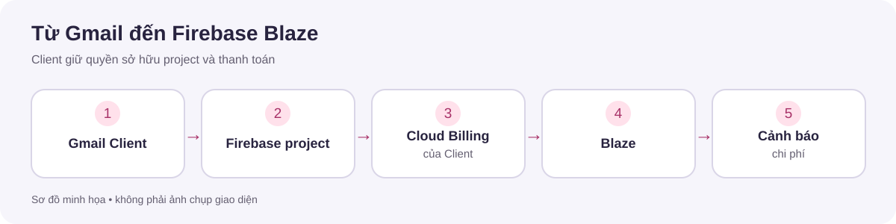
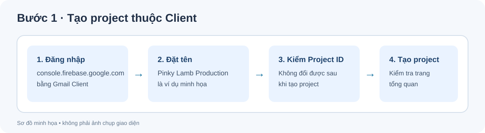
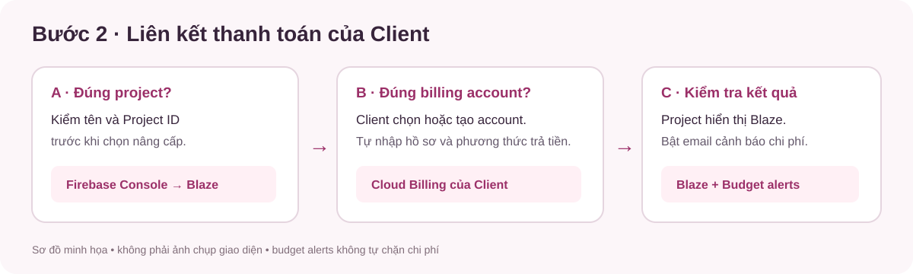
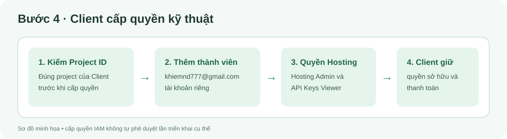

# Hướng dẫn Client mở Firebase Blaze bằng tài khoản Gmail sẵn có

**Cập nhật:** 23/10/2026. **Đối tượng:** người đại diện Client sở hữu Firebase project và thanh toán. **Kết quả:** project thuộc tài khoản Client, hiển thị gói **Blaze**, liên kết đúng Cloud Billing account và có cảnh báo ngân sách. Tài liệu này chỉ hướng dẫn; chưa tạo tài khoản hay bật dịch vụ nào.

Client đã có Gmail thì **không cần đăng ký một tài khoản Firebase riêng**. Gmail đó dùng để đăng nhập Firebase Console; **Blaze là gói của Firebase project**, không phải một tài khoản đăng nhập mới.

> Các hình dưới đây là **sơ đồ minh họa**, không phải ảnh chụp Firebase Console. Tên và vị trí nút có thể thay đổi. Hãy đối chiếu tên project và tài khoản thanh toán trước khi xác nhận.

## Chuẩn bị

- Một tài khoản Gmail mà Client kiểm soát lâu dài. Người này sẽ đăng nhập và là chủ quản lý ban đầu. Nên bật xác minh hai bước cho Google Account.
- Tên project mong muốn, tên pháp lý và địa chỉ thanh toán của Client; thông tin thuế nếu giao diện yêu cầu.
- Phương thức thanh toán được Google Cloud hỗ trợ tại quốc gia của Client. Client tự nhập thông tin trong Google Cloud; không gửi số thẻ, CVV, mật khẩu hoặc mã xác minh cho đơn vị phát triển.
- Người chịu trách nhiệm nhận email cảnh báo chi phí và mức ngân sách tháng do Client quyết định.

**Lưu ý:** Blaze là gói tính phí theo mức sử dụng, không phải thuê bao cố định. Việc chuyển sang Blaze liên kết Firebase project với Cloud Billing account. [Firebase pricing plans](https://firebase.google.com/docs/projects/billing/firebase-pricing-plans).

## Bước 1 — Đăng nhập và tạo Firebase project

1. Mở [Firebase Console](https://console.firebase.google.com/) và đăng nhập bằng Gmail của Client.
2. Chọn nút tạo project mới. Nếu Client đã có Google Cloud project dành riêng cho Pinky Lamb, chọn tùy chọn thêm Firebase vào project đó thay vì tạo một project trùng lặp.
3. Nhập tên dễ nhận diện, ví dụ `Pinky Lamb Production`. Kiểm tra **Project ID** trước khi tiếp tục: Google tạo ID duy nhất và không cho đổi sau khi tạo project.
4. Đọc và chấp nhận các điều khoản hiện trên màn hình. **Gemini in Firebase** và **Google Analytics** là lựa chọn tùy chọn; chỉ bật nếu Client đã quyết định sử dụng.
5. Chọn **Create project** và chờ trang tổng quan xuất hiện. Ghi lại **Project ID** (không cần gửi ảnh chụp chứa thông tin cá nhân).

**Tự kiểm:** Firebase Console hiển thị đúng tên và Project ID. Nếu Client chưa có nhu cầu dùng dịch vụ tính phí, có thể dừng ở đây; project mới thường bắt đầu ở gói Spark. [Hướng dẫn tạo Firebase project](https://firebase.google.com/docs/web/setup).

## Bước 2 — Chọn Cloud Billing account của Client

1. Trong Firebase Console của **đúng project**, tìm phần gói hiện tại hoặc **Usage and billing**, rồi chọn tùy chọn nâng cấp lên **Blaze**.
2. Nếu Client đã có Cloud Billing account do mình quản lý, chọn account đó và kiểm tra tên trước khi liên kết. Không chọn account cá nhân của nhà phát triển.
3. Nếu chưa có, mở [Google Cloud — Manage billing accounts](https://console.cloud.google.com/billing) bằng cùng Gmail; chọn **Create account**.
4. Điền tên Cloud Billing account. Chọn quốc gia đúng với địa chỉ thanh toán. Quốc gia quyết định tiền tệ và phương thức thanh toán; Google không cho đổi quốc gia của account sau khi tạo.
5. Chọn hoặc tạo **Google payments profile**. Nếu Client là công ty, chọn loại hồ sơ phù hợp với pháp nhân và nhu cầu quản lý của công ty; kiểm tra kỹ vì loại hồ sơ thanh toán không thể đổi sau khi tạo.
6. Client tự nhập thông tin pháp lý, thuế và phương thức thanh toán theo biểu mẫu. Chọn **Submit and enable billing** khi đã kiểm tra. Nếu được yêu cầu xác minh email hoặc phương thức thanh toán, Client hoàn tất ngay trong giao diện Google.
7. Quay lại Firebase Console; chọn Cloud Billing account vừa tạo và xác nhận nâng cấp cho **đúng Project ID**.

**Tự kiểm:** project hiển thị **Blaze** và liên kết với Cloud Billing account của Client. Cloud Billing account có phương thức thanh toán hợp lệ. Google có thể ghi một khoản tạm giữ để xác minh thẻ; khoản đó không đồng nghĩa với phí sử dụng dịch vụ. [Tạo Cloud Billing account](https://cloud.google.com/billing/docs/how-to/create-billing-account), [phương thức thanh toán](https://cloud.google.com/billing/docs/how-to/payment-methods).

**Nếu không thấy nút nâng cấp hoặc không chọn được billing account:** kiểm tra Gmail đang đăng nhập, quyền trên Firebase project và quyền trên billing account. Dừng tại đây nếu project hoặc account hiển thị không đúng; không chọn đại một account khác. [Quyền cần thiết](https://firebase.google.com/docs/projects/iam/permissions).

## Bước 3 — Đặt cảnh báo chi phí

1. Trong Firebase Console, mở **Project settings → Usage and billing → Details & settings**.
2. Ở phần **Budget alerts**, chọn **Create first budget**. Google sẽ mở trang **Budgets & alerts** của Cloud Billing.
3. Tạo budget theo **đúng project** và ban đầu chọn **All services**. Nhập mức ngân sách tháng do Client chấp nhận. Chọn các ngưỡng email cần nhận, ví dụ 50%, 90% và 100%.
4. Kiểm tra người nhận email cảnh báo và lưu budget. Xem lại tại Firebase Console hoặc Google Cloud Console.

**Quan trọng:** budget dạng **alerts-only chỉ gửi cảnh báo; không tự ngừng dịch vụ hoặc giới hạn hóa đơn**. Một số dịch vụ có lựa chọn spend cap riêng, nhưng cần đánh giá hậu quả ngừng dịch vụ trước khi bật. [Hướng dẫn budget Firebase](https://firebase.google.com/docs/projects/billing/budget-alerts).

## Bước 4 — Cấp quyền kỹ thuật cho `khiemnd777@gmail.com`

Client giữ quyền sở hữu Firebase project, Cloud Billing account và phương thức thanh toán. Sau khi kiểm tra đúng Project ID, Client thực hiện:

1. Trong Firebase Console, mở **Project settings → Users and permissions**. Chọn thao tác thêm thành viên mới.
2. Nhập **`khiemnd777@gmail.com`**. Đối chiếu chính xác địa chỉ trước khi lưu.
3. Nếu phạm vi đã thống nhất là **thiết lập, cấu hình và triển khai Firebase Hosting của website Pinky Lamb**, cấp vai trò **Firebase Hosting Admin** (`roles/firebasehosting.admin`). Để tài khoản này triển khai qua Firebase CLI, cấp thêm **API Keys Viewer** (`roles/serviceusage.apiKeysViewer`) trong **Google Cloud Console → IAM & Admin → IAM** của cùng project. Các vai trò này cho phép thao tác Hosting; chúng không cấp quyền quản lý Cloud Billing. [Vai trò Hosting và yêu cầu CLI](https://firebase.google.com/docs/projects/iam/roles-predefined-product).
4. Kiểm tra danh sách thành viên sau khi lưu. Yêu cầu người phát triển xác nhận rằng họ nhìn thấy **đúng Project ID** bằng tài khoản riêng; không gửi mật khẩu hoặc mã xác minh.

**Phạm vi ủy quyền:** `khiemnd777@gmail.com` được chuẩn bị cấu hình và thực hiện triển khai kỹ thuật **chỉ cho project, dịch vụ và bản phát hành mà Client đã thống nhất**. Việc thêm tài khoản vào IAM là cấp khả năng truy cập, **không tự phê duyệt một lần deploy cụ thể**. Client giữ quyết định về nội dung, thời điểm phát hành, ngân sách và dịch vụ trả phí. Không cần cấp vai trò **Owner**, quyền **Billing Account Administrator**, hay quyền xem/sửa phương thức thanh toán cho tài khoản kỹ thuật chỉ để triển khai Hosting.

Nếu sau này Client duyệt triển khai **Cloud Functions hoặc CMS online**, phải xác định quyền bổ sung theo thiết kế thực tế. Theo Firebase, triển khai Functions bằng tài khoản không phải Owner cần **Cloud Functions Admin** và **Service Account User**; không cấp hai quyền này chỉ vì đã mở Blaze. [Quyền triển khai Functions](https://firebase.google.com/docs/projects/iam/permissions).

Với CI/CD, dùng danh tính triển khai riêng của project do Client quản lý. Không lưu phiên đăng nhập cá nhân của Client hoặc `khiemnd777@gmail.com` thành credential lâu dài trong CI/CD. Trước khi cấu hình CI/CD hoặc deploy, hai bên thống nhất Project ID, dịch vụ, quyền và người phê duyệt phát hành. Việc có Blaze **không có nghĩa** CMS local hiện tại đã sẵn sàng chạy trên cloud; xem [tài liệu chuẩn bị deploy](FIREBASE-DEPLOY-PREPARATION.md).

## Client xác nhận hoàn tất

- [ ] Tôi đăng nhập bằng Gmail do Client kiểm soát.
- [ ] Firebase project có tên và Project ID đúng.
- [ ] Project hiển thị gói **Blaze**.
- [ ] Cloud Billing account và payments profile thuộc Client; phương thức thanh toán hợp lệ.
- [ ] Budget và người nhận email cảnh báo đã được kiểm tra.
- [ ] `khiemnd777@gmail.com` đã được thêm vào **đúng Project ID** với quyền Hosting đã thống nhất; Client vẫn giữ quyền sở hữu và thanh toán.

**Không gửi:** mật khẩu, mã OTP, số thẻ/CVV, bản sao giấy tờ thanh toán. Khi cần đối chiếu, chỉ chia sẻ Project ID, tên billing account đã che thông tin nhạy cảm và trạng thái các ô kiểm trên.
