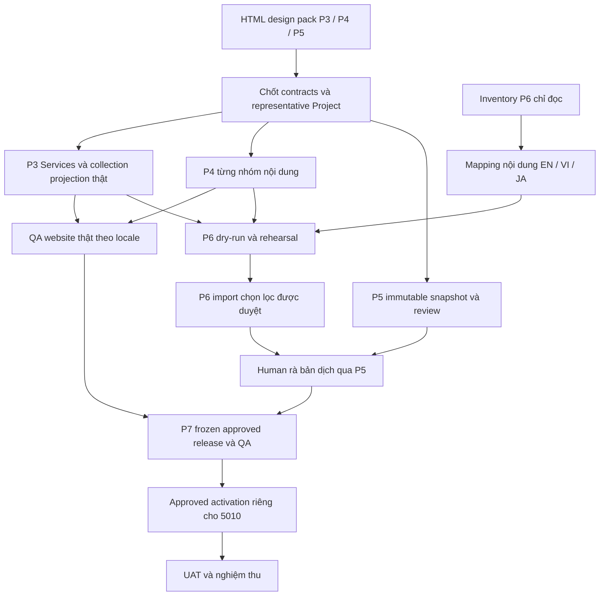

# MULTILINGUAL-001 v2 — Kế hoạch P0–P7 theo mockup đã duyệt

## Trạng thái hiện hành — đã hoàn tất theo xác nhận của Khiêm

**ĐÃ HOÀN TẤT / CLOSED_BY_HUMAN_CONFIRMATION — 17/10/2026 (Asia/Ho_Chi_Minh).** Xem [xác nhận trực tiếp, phạm vi đóng và bảng trạng thái hiện hành](../../tasks/plan.md). Khiêm xác nhận các plan đã xong và giao chỉ đồng bộ tài liệu, không sửa code hoặc chạy lại kiểm thử.

Các trạng thái chờ duyệt/chưa hoàn tất, checkbox và bước tiếp theo trong phần bên dưới thuộc lịch sử trước xác nhận đóng; không tự mở lại plan/task từ các ghi nhận đó. Giữ nguyên bằng chứng PASS/FAIL/NOT_RUN, cờ kỹ thuật và giới hạn đã ghi nhận. Lần đồng bộ này không xác minh runtime, không ghi nhận release hoặc cấp quyền thực thi mới.

## Nội dung lịch sử trước xác nhận đóng

Ngày **16/10/2026**, Asia/Ho_Chi_Minh. Owner kế hoạch: **root / Project Coordinator**. Trạng thái hiện hành: **P0_COMPLETE / P1_CORE_VERIFIED_ACCEPTANCE_OPEN / P2_REVIEW_READY / P3–P7_DETAIL_v1_APPROVED / DESIGN_PREPARATION**. Kế hoạch chi tiết đã duyệt; chỉ chuẩn bị template lock, HTML và bundle cụ thể, chưa mở implementation ứng dụng.

## 1. Quyết định, nguồn chuẩn và quyền

**Quyền hiện hành 16/10/2026:** P1 v2 và A2 đã được duyệt riêng; P1 còn tiêu chí nghiệm thu mở. P2 v1 đã triển khai và kiểm chứng trong QA local, chờ nghiệm thu người dùng. Người dùng đã ghi “Approved MULTILINGUAL-001 — kế hoạch chi tiết P3–P7 v1.”, giao hoàn thiện P7-00a, bộ HTML D3/D4/D5 và bundle Project đại diện. Quyền này cho phép docs/mockup/design QA; lượt đầu không sửa source ứng dụng, mutation/import hoặc activation :5010. [P1 hiện hành](MULTILINGUAL-001-P1-v2.md), [P2 hiện hành](MULTILINGUAL-001-P2-v1.md), [manifest kế hoạch P3–P7](../../approvals/MULTILINGUAL-001-P3-P7-v1.plan.json).

Người dùng trực tiếp xác nhận trong chat ngày 16/10/2026:

> Đây mới là UI UX mà tao cần. tao duyệt mockup này, mày rework lại plan P0 -> P7 theo mockup này.

Quyết định này **duyệt mockup và cho phép viết lại kế hoạch P0–P7**. Chưa cấp quyền rework ứng dụng, ghi dữ liệu, migration hay activation :5010. P1 v1+A1 là lịch sử implementation có thật; UI cũ đã bị từ chối. Không dùng approval cũ để tiếp tục cách triển khai đã dừng.

Nguồn hiện hành:

- **Kế hoạch toàn chức năng:** tài liệu v2 này, thay kế hoạch triển khai/UI trong [v1](MULTILINGUAL-001-v1.md). Giữ các quyết định nghiệp vụ không bị thay thế và bằng chứng cũ.
- **Tasks duy nhất của replan:** [MULTILINGUAL-001-v2](../tasks/MULTILINGUAL-001-v2.md). Các task v1 giữ lịch sử; không chạy song song checklist cũ và mới.
- **Thiết kế được duyệt:** [HTML](../../mockups/multilingual-p1-redesign-v1.html), [CSS](../../mockups/multilingual-p1-redesign-v1.css), [JS](../../mockups/multilingual-p1-redesign-v1.js), [tự review](../../mockups/MULTILINGUAL-P1-REDESIGN-v1.md). File/hash chính xác và approval provenance nằm trong [design record](../../approvals/MULTILINGUAL-001-v2.design.json).
- **Bằng chứng P1 v1:** [tasks/evidence](../tasks/MULTILINGUAL-001-P1-v1.md), [scope lịch sử và hold](../../approvals/MULTILINGUAL-001-P1-v1.scope.json). Không sửa frozen approval snapshots hoặc relabel kết quả cũ thành nghiệm thu mới.

Mockup là chuẩn trực tiếp cho **workspace Hero, quản lý bản dịch, preview và Hero EN/VI/JA**. Mockup không có thiết kế hoàn chỉnh của danh sách dự án/dịch vụ, review queue, migration hoặc switch trên website đầy đủ. Các phần đó kế thừa hệ thống thiết kế; màn hình/luồng mới phải được trình bằng HTML để duyệt trước code sản phẩm. Không suy rằng duyệt Hero là đã duyệt tất cả UI P0–P7.

## 2. Kết quả người dùng cần nhận

Website local :5010 có ba bản: `/` tiếng Anh mặc định, `/vi/` tiếng Việt, `/ja/` tiếng Nhật. CMS luôn dùng tiếng Việt. Người biên tập chọn ngôn ngữ nội dung, sửa đúng đối tượng, lưu độc lập, xem đúng bản đã lưu, gửi/duyệt theo quyền và ngôn ngữ khi P5 hoàn thành. Không phải ba website hoặc ba bộ project/service IDs.

Luồng ưu tiên: **chọn nhóm/đối tượng → chọn ngôn ngữ → biên tập → lưu bản đang chọn → xem bản đã lưu**. Editorial và phục vụ website là bước riêng. Không tự dịch, tự gán nội dung cũ là tiếng Anh hoặc cho bản nháp ra website.

## 3. Contract UI/UX phải giữ từ mockup

| ID | Thành phần được duyệt | Yêu cầu khi áp vào ứng dụng | Bằng chứng nghiệm thu |
| --- | --- | --- | --- |
| UX01 | Sidebar, breadcrumb, tab Đầu trang / Hero / SEO | Giữ ngữ cảnh CMS; bản dịch Hero chỉ nằm trong tab Hero, không ghép cuối Đầu trang | Đối chiếu riêng từng tab desktop/mobile |
| UX02 | Một workspace “Biên tập bản dịch” | Không lặp tiêu đề nhiều tầng, không lộ runs/revision/hash trong luồng chính | Cùng viewport, cùng trạng thái với HTML |
| UX03 | EN / VI / JA với trạng thái bản | EN mặc định lần đầu; giữ lựa chọn khi đổi nhóm sau này; locale nội dung không đổi nhãn CMS | Chọn, refresh theo chính sách được chốt, đổi nhóm/đối tượng |
| UX04 | Một hành động lưu theo ngôn ngữ | “Lưu bản Anh/Việt/Nhật” chỉ ghi đúng bản; không đồng thời hiển thị Lưu website/Gửi duyệt gây hiểu nhầm trong ngữ cảnh bản dịch P1 | Request/readback và ảnh trạng thái |
| UX05 | Tiêu đề soạn liền mạch, toolbar nhấn mạnh | Ánh xạ đúng runs hiện có; sửa chữ không làm mất định dạng ngoài vùng sửa; không có UI thêm/xóa từng run | Round-trip nội dung thật + chọn chữ bằng keyboard/pointer |
| UX06 | Thông điệp → CTA → thông tin bổ sung | Giữ thứ tự, disclosure và label trong mockup; ảnh/đích CTA dùng chung chỉ đọc trong bản dịch | Có/không CTA phụ, alt decorative/non-decorative |
| UX07 | Bản đã lưu cạnh form; có mở rộng | Preview dùng cùng composition và CSS với Hero đầy đủ, ghi rõ ngôn ngữ/loại bản và kích thước khi thu nhỏ; chữ chưa lưu không tự xuất hiện | Đối chiếu saved identity và ảnh full/scaled |
| UX08 | Đối chiếu nội dung gốc chỉ đọc | Nguồn không mặc định là EN; không sao chép/ghi đè âm thầm; không ép màn hình ba cột | Mở/đóng đối chiếu, bảo toàn bản đang sửa |
| UX09 | Mobile Biên tập / Bản đã lưu và thanh lưu dưới | Một cột; thanh lưu có locale/trạng thái, không che field, thông báo hoặc nút dialog; preview mở rộng dùng được | 390×844, 320px và keyboard/focus trong container |
| UX10 | Ở lại / Bỏ thay đổi và chuyển / Lưu và chuyển | Lưu lỗi ở lại, giữ chữ; pending khóa thao tác liên quan; navigation phải bảo vệ cả thay đổi chung và bản dịch | Luồng thật, hai tab/CAS, lỗi mạng hữu hạn |
| UX11 | Empty / readonly / error / conflict | Không báo “Đã lưu” cho bản chưa tồn tại; không fake success; từ chối quyền ở cả backend | State-specific runtime và API evidence |
| UX12 | Hero theo từng ngôn ngữ | Dùng artwork/logo hiện có và bố cục đã duyệt; chữ Nhật dùng typography phù hợp, ngắt dòng có chủ đích; không tự cắt chữ/ẩn nội dung để vừa | EN/VI/JA desktop/mobile và nội dung dài hợp lệ |

**Bỏ vật liệu prototype khi tích hợp:** banner “Bản thiết kế”, OWNER giả, dữ liệu mẫu, nút đặt lại, bộ mô phỏng tình huống, fake save/delay/toast thành công, memory-only persistence và điều khiển review CMS/Hero. Bộ EN/VI/JA trong view “Thiết kế Hero” là công cụ review; không được sao chép thành switch website rồi coi P2 đã xong. Giữ phiên Auth, role và dữ liệu thật từ controller/API. Không copy JS prototype làm controller sản phẩm.

**Contract tích hợp P0 đã chốt:** UI mới thay UI Hero cũ. Source/shared read-only; không phải giữ đường sửa form cũ, không thêm nút/tab hoặc xin lại mockup. Toolbar toàn website bị ẩn đúng localized Hero context và khôi phục bên ngoài. Loading/Auth/source-drift/unknown-commit dùng vùng trạng thái/controls hiện có. Chi tiết tại contract P0; mọi thay đổi visible khác mockup vẫn cần quyết định riêng, không tự thêm.

## 4. Trạng thái thực tế và cách tái sử dụng P1

**Snapshot source tại lượt replan ban đầu, không phải trạng thái source hiện tại:** `site-media-editor.mjs` đang mount editor ngôn ngữ sau `mountSiteSettings`, độc lập tab hiện tại. `hero-localization-renderer.mjs` còn gọi `renderSiteHero` và CSS baseline cũ. Contract Hero hiện có heading 1–3 dòng, tối đa 8 runs/100 ký tự mỗi dòng; description tối đa 12 runs/1000 ký tự, CTA 80, eyebrow 120, footnote 240, note/alt 300. Preview có sandbox rỗng, kiểm identity/hash và quản lý Blob URL. Đây là kiểm source, không phải runtime mới.

| Phần P1 v1 | Xử lý trong v2 |
| --- | --- |
| Sidecar Hero, contract, CAS, idempotency, audit và exact apiFetch admission A1 | Tái sử dụng sau đối chiếu digest/contracts; không viết lại chỉ vì đổi UI |
| Controller dirty/generation fencing, retry/response-loss, Auth lifecycle | Giữ invariants; chỉnh adapter/lifecycle cần thiết để tích hợp đúng tab và actions |
| Panel append sau Đầu trang; per-run fieldsets; action/metadata lẫn nhau | Thay bằng workspace đúng mockup, không chắp thêm CSS vào form cũ |
| Renderer Hero và typography hiện tại | Làm lại theo approved Hero composition; không chỉ thay nội dung hoặc giảm cỡ chữ Nhật |
| CSS/resource pipeline preview và export | Cấp tài nguyên thiết kế mới có xác minh, cùng renderer cho private/QA; không sửa baseline |
| Unit38/browser17/build/lint và before/after cũ | Giữ proof boundaries. Tái dùng case không bị ảnh hưởng sau kiểm digest; UI/layout/runtime bị đổi cần kiểm lại |
| EN revision5, VI/JA revision1, base Home v3 revision0 theo evidence trước | Dùng để chuẩn bị preflight mới, không coi còn đúng nếu chưa readback. Không reset/seed/reimport |
| AC04 chỉ có OWNER, các role khác NOT_RUN | Giữ mở; runtime role cần phiên demo hợp lệ do người dùng cấp, không tạo role/token để có PASS |

Human đã duyệt **mockup**, chưa nghiệm thu UI sản phẩm hiện có hoặc bản dịch thử. Backend/source PASS không thay nghiệm thu hình ảnh và hành vi sau rework.

## 5. Nguyên tắc dữ liệu, quyền và tích hợp

- Giữ HTML/CSS/vanilla JS; tái sử dụng components/tokens/Lucide hiện có. Không thêm framework, dịch vụ AI, dependency/font binary hay nguồn ảnh mới như hệ quả ngầm của replan.
- Dữ liệu chung sở hữu ID, thứ tự, quan hệ, asset/target/factual source. Bản localized sở hữu text/alt và metadata locale/version/nguồn. Default website EN không xác định ngôn ngữ của nguồn.
- P1 giữ `cmsLocalizedHeroDrafts/home-v3--{en|vi|ja}` và operation store hiện có. Contract toàn site P0 định nghĩa public interface theo entity ID + locale; không ép mọi module vào một schema chung hoặc dùng nhiều cột `titleJa` rời rạc. P3/P4 mở rộng theo module, không migration ngầm dữ liệu legacy.
- Lưu từng resource/locale có expected revision, idempotency key và readback. Timeout/response loss phải giữ ý định đang chờ xác nhận, không tạo request ghi mới tùy tiện. Base drift không tự rebase; locale/entity switch không mang intent sang bản khác.
- Chỉ cho rich text `NONE/STRONG/ACCENT` theo contract; paste/selection/IME tiếng Nhật/Unicode phải round-trip. Không arbitrary HTML/JS, không tự cắt dữ liệu khi vượt run/text/encoded byte limits.
- Giữ Auth/ACL, host/origin, timeout/logout và deny-by-default transport. Mỗi task thêm API phải tính cả caller, route và admission trong `admin/auth.mjs`, tránh lặp thiếu transport A1. Roles giữ nguyên; self-review guard không được bỏ vì thiếu người thử.
- Shared save và localized save là hai phạm vi ghi có nhãn rõ. Đổi nguồn chung phải cảnh báo ảnh hưởng các bản dịch và đánh dấu cần đối chiếu theo contract P5; không âm thầm ghi cả ba bản.

### 5.1 CSS và preview — thay đổi kỹ thuật phải xin duyệt trong P1 v2

Private preview hiện lấy style từ :5010/baseline; giữ cách này sẽ không thể giống mockup mới. **Đề xuất:** stylesheet Hero do source ứng dụng sở hữu, phạm vi class riêng; server chỉ tạo tài nguyên stylesheet phiên bản đã biết, có bytes/hash/size. Private preview xác minh bytes rồi render style nội bộ với **CSP hash đúng nội dung stylesheet**, giữ `sandbox=""`, `script-src 'none'`, `connect-src 'none'`, `form-action 'none'` và các origin media/font hiện có. QA export ghi đúng CSS bytes đó thành file cùng artifact; dùng policy self tương ứng. Không nhận CSS do người biên tập nhập và không dùng wildcard/`unsafe-inline` cho style element để né CSP.

Đây là **cơ chế Proposed, chưa triển khai hoặc kiểm chứng**; thay policy nhận style là delta có chủ đích so với P1 v1, phải nằm rõ trong scope P1 v2 được duyệt. P0 chốt source stylesheet/resource contract và threat cases trước coding. Kiểm tamper, hash mismatch, payload limits, path containment, CSP thực thi, logout/cleanup và private data boundary. Delta cuối P0 nêu rõ parent srcdoc inheritance: chỉ thêm đúng fixed stylesheet hash vào style-src parent và child; mọi directive/origin khác giữ. Đây là phạm vi kỹ thuật xin duyệt cùng P1 v2, không tự thực hiện từ approval plan.

Saved preview và QA Hero dùng cùng projection/renderer/assets để không có hai bản thiết kế lệch nhau. Parent CMS xử lý việc thu nhỏ/đổi kích thước iframe; không cho script vào tài liệu private. Không lấy HTML private có draft/token đưa trực tiếp thành public output.

## 6. P0–P7 và thứ tự phụ thuộc

| Phase | Kết quả bàn giao | Điều kiện bắt đầu / kết thúc | Trạng thái hiện tại |
| --- | --- | --- | --- |
| P0 — Chốt thiết kế và contract | Pin approved mockup; mapping UI→controller→data; field/source/URL/state contracts; scopes và AC | Bắt đầu bằng tài liệu. Kết thúc khi design gaps được xử lý, scope phase có thể duyệt; không đòi P0 toàn site xong mới sửa Hero | P0 COMPLETE_DOCUMENTED; bundle P1 đã được duyệt riêng |
| P1 — Rework Hero xuyên suốt | CMS đúng mockup → lưu thật en/vi/ja → private preview → QA Hero cùng thiết kế | Sau P0 phần Hero + Approved P1 v2. Một màn hình đại diện đúng layout/lifecycle trước khi mở rộng | P1 v2 core/source verified; acceptance còn mở, xem task P1 |
| P2 — Switch và khung website | Header/mobile/footer switch, URL locale, dictionary/navigation/brief guard trên shell QA riêng | Mockup/scope P2 đã duyệt; QA riêng, chưa đổi :5010 | REVIEW_READY; human acceptance pending |
| P3 — Dự án và dịch vụ | List trạng thái ba ngôn ngữ → chọn đúng entity/locale → edit/save/preview | Dùng UX primitives P1, contract entity P0; mockup list/dialog được duyệt. Không bắt buộc chờ P2 nếu không có dependency | PROPOSED |
| P4 — Các nhóm còn lại và SEO | Header, khách hàng, giới thiệu, IP, liên hệ, footer, SEO và UI copy theo locale | Sau contract shell P2 và collection P3 khi có quan hệ. Mockup các khác biệt/màn hình mới được duyệt | PROPOSED |
| P5 — Editorial theo locale | Immutable snapshot, gửi/duyệt/yêu cầu sửa, source-check/stale, projection đủ điều kiện | Contract review được chốt sớm ở P0; tích hợp sau các loại content P1/P3/P4. Không tự đóng/mở M3/M4 | PROPOSED; quyền/phiên reviewer là prerequisite thật |
| P6 — Nội dung cũ và bản dịch | Inventory → dry-run → mapping có chọn lọc → import thử → rà bản dịch | Có contracts đích; mutation sau Approved riêng và backup/restore rehearsal. Inventory chỉ đọc có thể chuẩn bị sớm | PROPOSED; chưa có editorial acceptance EN/VI/JA |
| P7 — :5010 và UAT | Frozen approved locale bundle, phục vụ đúng 3 URL, nghiệm thu chức năng | P2–P6 đạt các tiêu chí liên quan, đủ nội dung duyệt; Approved riêng cho activation local | PROPOSED; baseline vẫn read-only |

Đường triển khai dự kiến: **P0(Hero) → P1 đại diện → P2 và P3 theo dependency thật → P4 → P5 → P6 → P7**. P0 contract editorial/migration và P6 inventory có thể khảo sát sớm để tránh thiết kế sai; điều này không cấp quyền mutation sớm. Không tạo nhiều agent hoặc nhiều quy trình song song mặc định.

### P0 — nền tảng thiết kế và contract

Pin ba file HTML/CSS/JS đã duyệt bằng hash; mô tả phần giữ, prototype bỏ, khác biệt cần thêm. Mapping source/shared read-only và topbar theo UI mới, không dùng form cũ làm constraint. Chốt adapter rich text và stylesheet/CSP delta; record URL, missing translation, từ điển UI, entity và editorial boundaries. Tasks P0-01…04 trong task record.

**Nghiệm thu P0:** người đọc xác định được nguồn thiết kế, quyền và owner; mỗi phase có outcome/depends/AC/check; P1 v2 có đủ exact source/caller/test/resource paths và data/runtime writes để duyệt. Không coi paths dự kiến của phase sau là allowlist thực thi. Chưa duyệt phần mở rộng HTML thì criterion tương ứng còn mở.

### P1 — thay UI đã bị từ chối, giữ nền tảng dữ liệu

Làm workspace Hero thật trước; nối controller hiện có thay fake prototype state. Preview private, bản mở rộng và QA export phải dùng thiết kế mới. Chuẩn hóa component và lifecycle trong phạm vi Hero, không refactor toàn CMS. Bỏ panel sai vị trí và các nút/metadata kỹ thuật khỏi luồng chính; vẫn có công cụ QA dành operator ở nơi phụ đúng quyền.

**Nghiệm thu P1:** UX01–UX12 cho Hero; thật EN/VI/JA save/readback, retry/CAS, dirty switch/tab/group, errors, source drift, pending/logout. Không thay base hoặc locale khác khi lưu. Đối chiếu mockup và app **riêng từng trang** tại 1440×900 và 390×844, zoom100%, cùng dữ liệu/trạng thái/scroll; 768/320 kiểm bổ sung. Round-trip runs và glyph/IME, controls trong container đều dùng được. Role matrix còn thiếu không được chuyển PASS. P1 không bật switch website :5010 và không gửi duyệt bản dịch.

### P2 — ngôn ngữ website và điều hướng

**Hiện hành:** P2 v1 đã có mockup được duyệt, source và scoped QA được kiểm chứng; xem [bàn giao P2](MULTILINGUAL-001-P2-v1.md). Switch sau nav/trước CTA, mobile ngoài hamburger và footer được giữ làm chuẩn. QA :4175 hiện ghép Hero P1 với CASE1/filter minh họa; chưa phải projection nội dung thật. P3/P4 phải nối cùng tương tác với ID/category/section/availability thật, không sao chép dữ liệu mẫu sang website :5010.

**Nghiệm thu P2:** `/`, `/vi/`, `/ja/` truy cập trực tiếp/refresh/back/forward đúng locale; root EN, không flash VI trước. Giữ section, filter hợp lệ và cùng entity ID nếu có bản đích. Nếu không có bản dịch, modal đóng hoặc về section hợp lệ kèm thông báo đã chốt, không mở item khác. Brief đang sửa có lựa chọn ở lại/bỏ trước chuyển; không lưu thông tin cá nhân vào storage. Nav, labels/aria và keyboard/touch cùng locale; chưa đổi Hosting :5010.

### P3 — dự án và dịch vụ

Kế thừa list/dialog hiện có: hiển thị trạng thái EN/VI/JA, bấm vào đúng bản; trạng thái dịch khác trạng thái hiển thị/entity. Chỉnh text/alt/caption trong bản dịch; ID, khách hàng/năm/category/service links/media/order/visibility chung có khu riêng. Cần HTML representative một project list→editor/dialog trên desktop/mobile trước implementation; service áp cùng pattern nhưng kiểm riêng.

**Nghiệm thu P3:** cùng stable ID trên ba bản, lưu chỉ một locale, list status/filter đúng sau reload, dirty guard qua dialog/entity/group, preview dùng saved version. Missing translation không làm sai counts/featured/category/form references. Project/service quan hệ không bị đổi do dịch. Backend ACL/CAS và server filtering/pagination tương xứng dữ liệu; không thêm search engine hoặc tải vô hạn để lọc client.

### P4 — hoàn tất nhóm nội dung và SEO

Field matrix kế thừa v1: Header/nav/brand text; khách hàng intro/alt; About text có nguồn; IP copy/CTA label; Contact instructions/validation; Footer copy/links; SEO title/description/share text. CMS giữ tám nhóm và tiếng Việt. Dữ kiện, logo, liên hệ, thứ tự/visibility và target dùng chung; không biến tên pháp lý hoặc claim thành dữ kiện mới khi dịch. UI dictionary có owner trong source, không thành text CMS tự do.

**Nghiệm thu P4:** mỗi nhóm có evidence riêng, không suy từ Hero. Saved preview và full artifact cùng locale từ header tới footer, modal/form/validation/aria không lẫn ngôn ngữ. Assets hoạt động dưới subpath; glyph/font/license kiểm thực tế trước thêm font. Canonical/hreflang/x-default/sitemap chỉ tham chiếu bản đủ điều kiện; artifact local vẫn noindex. PDF/video/artwork có chữ không được coi đã dịch bởi đổi locale. Form vẫn mailto/copy, không thêm backend lead.

### P5 — gửi và duyệt theo ngôn ngữ

HTML review queue/detail phải làm rõ đối tượng, locale, nguồn, saved revision, shared/media versions và nội dung thay đổi. Quy trình: Chưa dịch → Bản nháp → Chờ duyệt → Đã duyệt hoặc Yêu cầu sửa. Cần cập nhật là cờ đối chiếu nguồn; đang phục vụ là trạng thái riêng. Tái sử dụng boundaries/source attestations hiện có khi phù hợp, không gắn nút gửi duyệt vào P1 draft rồi tự tạo snapshot APPROVED.

**Nghiệm thu P5:** snapshot immutable gắn locale/content/shared/media/source identity; reviewer khác submitter theo self-review guard; source cần kiểm đủ bằng chứng. Sửa sau submit không làm đổi snapshot; source đổi đánh dấu stale, không làm mất bản đã duyệt đang phục vụ. Approve VI không approve EN/JA. Unauthorized/duplicate/race/retry đều kiểm. Chỉ có OWNER thì review acceptance giữ NOT_RUN, nêu prerequisite/owner; không lách bằng token hoặc đổi role. Scope phải xác định phần bổ sung M3 liên quan; không tự mở M4 publication/history.

### P6 — chuyển nội dung và hoàn thiện bản dịch

Kiểm kê ngôn ngữ từng field thực tế trước map. Nguồn VI/EN trộn không đổi nhãn thành EN. Dry-run báo số bản tạo/cập nhật/bỏ qua/xung đột, stable IDs, shared/media/source dependencies và bytes. Import có expected revision/idempotency/batch boundaries, dừng khi sai context; không ghi đè bản mới hơn. Thử restoration ở fixture được phép trước retained-data migration. Người phụ trách nội dung rà EN/VI/JA; copy mẫu trong mockup không phải nội dung kinh doanh mặc nhiên được chấp nhận.

**Nghiệm thu P6:** input/output manifest, before/after hashes/counts/IDs và links khớp; retry không tạo trùng; interrupted run biết phần đã commit; restore/roll-forward khả thi được kiểm bằng rehearsal đúng quyền. Nội dung thiếu giữ thiếu; human editorial acceptance riêng từng locale; tài nguyên có chữ ghi giới hạn rõ. Không tự reset/seed/import lại Home v3.

### P7 — tích hợp website :5010 và nghiệm thu

Sinh artifact toàn site từ các snapshot locale hợp lệ và shared/media versions khớp, kiểm closure của mọi quan hệ trước output. Bắt buộc EN/VI/JA đủ Hero/nav/contact/SEO; project/service thiếu bản hợp lệ ẩn nhất quán cùng counts/featured/references; không fallback âm thầm tiếng Anh vào trang khác. Bundle có manifest; output ở thư mục task-owned mới, không overwrite `dist/`/`public-baseline`.

Activation :5010 là **scope vận hành riêng trong P7 cần Approved**: chốt config local, artifact đích, before-image, thao tác chuyển và phục hồi. Chỉ sử dụng `pinky-lamb-cms/infra-local/`; root `firebase.json` read-only. Nếu Hosting không thể chuyển riêng mà ảnh hưởng Auth/Firestore/Storage đang dùng, trình đúng operational delta và giữ activation HOLD; không restart cả bộ emulators cho tiện. Đây là phục vụ bundle local có kiểm soát, không triển khai publication/history/rollback machinery M4 hoặc cloud/Production.

**Nghiệm thu P7:** ba URL :5010 đúng output/locale/asset; EN default; switch và ngữ cảnh đúng; toàn site/modal/filter/brief mailto/copy/validation/aria đúng ngôn ngữ; bản nháp/private không lọt output, metadata nhất quán. Rehearsal phục hồi :5010 chỉ đổi nguồn phục vụ, không rollback dữ liệu CMS. Full flow CMS→save→review→approved artifact→:5010 có chứng cứ; người dùng nghiệm thu UI và người phụ trách nội dung nghiệm thu bản dịch riêng. Không suy thành LOCAL_COMPLETE của toàn CMS/M3/M4.

## 7. Bằng chứng, prerequisites và cách triển khai không làm lại vô ích

- Mỗi slice có một writer/source owner, contracts rõ trước consumers; chỉ thêm delegation khi có lợi ích và quyền. Root giữ plan/approval/index. Kiểm tra thực tế route High cho planning/review, Medium cho coding/test theo policy, không suy provider telemetry từ file config.
- Trước sửa: ghi digest source liên quan, trạng thái phiên/role và retained data cần bảo toàn trong đúng quyền. Không yêu cầu mật khẩu/token trong chat. Hiện chỉ có OWNER theo người dùng; owner bổ sung demo role là người dùng/quản trị được giao quyền.
- Một representative Hero EN/VI/JA được nối luồng thật và đối chiếu template trước mở rộng components sang P2/P3/P4. Confirmation này là kiểm evidence trong scope đã duyệt, không thêm một vòng human approval cho từng bug.
- Mỗi phase: contract/unit cho rules; integration/CAS/ACL theo phần đổi; lint/build phù hợp; rendered matched desktop/mobile cho UI và runtime luồng thật nếu claim phụ thuộc API. Không chạy full suite/reset/reseed theo thói quen. Reuse evidence còn hợp lệ; đánh dấu phần bị ảnh hưởng cần chạy lại.
- Evidence tối thiểu theo criterion: screen, locale/entity, role, data state, viewport, expected result, actual result, artifact/hash và PASS/FAIL/NOT_RUN. Không chụp mọi màn hình hàng loạt để thay kiểm tác vụ. Human design approval, source complete, runtime verified và human product acceptance là bốn trạng thái khác nhau.
- Nếu gặp lỗi: dừng luồng bị ảnh hưởng, giữ evidence, focused repair plan và kiểm lại đúng phần. Routine repair trong Approved còn hiệu lực không hỏi duyệt từng file; đổi approach/control/scope hoặc lệnh dừng của người dùng thì replan.

## 8. Rủi ro và quyết định còn mở

| Rủi ro / thiếu đầu vào | Xử lý đã đưa vào tasks | Owner / thời điểm |
| --- | --- | --- |
| Mockup memory-only chưa biểu đạt hết controller thật | P0 state contract đã chốt; P1-02 nối request intent và lifecycle thật, không copy fake controller | root + implementer, trước/ở P1 |
| Preview CSS/CSP khác mockup | P0-03/P1-04 có delta hash-pinned style và security checks rõ; nếu không đạt thì không claim parity | contract owner + reviewer, trước close P1 |
| Tái đưa form/entry cũ vì muốn giữ UX cũ | Quyết định human đã chốt: source/shared read-only, UI mới thay UI cũ; không thêm entry trong P1. Guard/toolbar theo mockup | root/implementer, AC01/02 P1 |
| Switch/list/review/migration chưa có mockup được duyệt | P2-01/P3-01/P4-01/P5-01/P6-01 trình HTML cần thiết; tái dùng pattern đã duyệt, chỉ mở phần mới | phase owner + human |
| Thiếu role demo và người rà Nhật | Không chế bằng chứng hoặc tự dịch để đóng AC; nêu NOT_RUN/owner, tiếp tục phần độc lập | người dùng/quản trị/nội dung trước acceptance liên quan |
| Aggregate locale approval giao M3/M4 | Contract P0 và scope P5/P7 nêu ranh giới; không tạo quyền phát hành từ trạng thái APPROVED | root trước phase approval |
| Retained data/source drift trong rework/migration | Preflight mới, CAS, backup/rehearsal, đối chiếu IDs/hashes; không reset data để test | implementer/QA theo mutation scope |

## 9. Trạng thái duyệt tiếp theo

**Đã duyệt:** mockup ba file theo design record, làm chuẩn UI/UX. **Đã thực hiện:** replan P0–P7 và hoàn tất P0 contract/bundle P1 v2 theo approval sau đó. **Chưa duyệt/chưa chạy:** implementation v2, UI mở rộng ngoài mockup, CSS/CSP delta, migration, role runtime bổ sung, activation :5010 và cloud/Production.

**Snapshot khi trình P1:** P0 phần Hero COMPLETE_DOCUMENTED; bundle P1 lúc đó chờ duyệt. Trạng thái hiện hành nằm ở đầu tài liệu, task P1/P2 và §10; không dùng snapshot này để phủ nhận approval P1/P2 đã có.

## Cập nhật hiện hành — P2 design review, 16/10/2026

P1 code/core đãhoàn tất, nghiệmthu còn mở theo [AC P1](../docs/MULTILINGUAL-001-P1-v2.md); không chuyển role/IME/cleanupB chưa kiểm thànhPASS. Đã chuẩn bị [mockup/scope P2 v1](../docs/MULTILINGUAL-001-P2-v1.md) và [task record](../tasks/MULTILINGUAL-001-P2-v1.md) theo yêu cầu chuyển tiếp. [P2manifest](../../approvals/MULTILINGUAL-001-P2-v1.scope.json) freeze3mockup/10candidatepaths, implementation_authorized=false; HTML desktop/mobile và dirty/missing/history mockup đã kiểm, chờ duyệt. Không applicationwrites/datawrites/activation5010 hoặc đóngP1 từ bước này. Các câu trạng thái trước đây giữ bối cảnh lúc trình; đoạn này là cập nhật hiện hành.

## Cập nhật hiện hành — P2 Approved, 16/10/2026

Người dùng đã gửi `Approved MULTILINGUAL-001 P2 v1 — switch/navigation QA local theo mockup và scope đã trình`. [Scope P2](../../approvals/MULTILINGUAL-001-P2-v1.scope.json) mở đúng10sourcepaths và QA4175; [task record](../tasks/MULTILINGUAL-001-P2-v1.md) là trạng thái thực thi duy nhất. P1 acceptance vẫn mở; P3–P7 chưa mở,5010 giữ nguyên. Bản scope P2 chi tiết thay mapping filenames dự kiến của plan tổng: không sửa full-site renderer/public-data/oldexporters.

**P2 handoff16/10:** source +scopedQAverified; [kết quả P2](../docs/MULTILINGUAL-001-P2-v1.md#kết-quả-thực-thi--16102026).30unit/export/legacyPASS,8browsercasesvalid theoaffectedrerun,17HTTPfiles/398protected/2193disk/5010giữnguyên. HumanacceptancePENDING; P1open/P3–P7khôngđổi.

## 10. Kế hoạch chi tiết P3–P7 — revision 1, đã duyệt 16/10/2026

**Plan Approved; design preparation only.** Phần này và các task P3–P7 trong [task record duy nhất](../tasks/MULTILINGUAL-001-v2.md) bổ sung chi tiết cho plan v2. Bản trước chỉnh được giữ trong evidence. Các câu trạng thái lịch sử phía trên không thay quyền hiện hành. Chưa có implementation approval P3–P7 và chưa có mockup mới ngoài Hero/P2 được duyệt.

### 10.1 Đích cuối và điểm xuất phát đã xác minh

Khi hoàn tất P7, người biên tập dùng CMS tiếng Việt để sửa đúng đối tượng và ngôn ngữ, lưu bản nháp, gửi một snapshot để người khác duyệt. Website local :5010 phục vụ đúng bản đã duyệt ở `/`, `/vi/`, `/ja/`, mặc định EN. Sửa bản nháp sau đó không tự thay website đang phục vụ.

| Verified từ source/records hiện tại | Hệ quả cho kế hoạch |
| --- | --- |
| P1 Hero có sidecar, CAS, idempotency, saved preview/QA2; GET/QA từ chối base revision/hash không khớp | Tái sử dụng UI và invariants; phải thiết kế rebase có chủ đích trước khi dữ liệu chung thay đổi. Không tự copy nguồn lên bản dịch |
| P2 chỉ có `CASE1`, filter `creative`, anchor `ip` và QA origin :4175 trong `site-locale.mjs` | Nối policy với dữ liệu thật; section thật có `ip-studio`, category thật là EVENTS/FILM/COMMUNICATIONS. Không hardcode danh sách dự án hoặc locale availability |
| Project/service schema giới hạn 24/12 records; gallery/scope tối đa 12; service cũ có `title` và `titleVi` | Giữ bounded queries, không dựng search engine. Bản dịch service có một tên theo locale; hai field cũ chỉ là nguồn đối chiếu/migration |
| V3 có immutable snapshots, review state, source attestations; backend chặn self-review | Kế thừa semantics, mở rộng identity theo đối tượng/locale; không bypass bằng OWNER |
| ACL hiện tại: EDITOR/OWNER lưu và gửi; REVIEWER/OWNER duyệt và kiểm nguồn; PUBLISHER chỉ đọc | Không tự thêm quyền publish hoặc thay role model. P7 là activation kỹ thuật local được duyệt riêng, không triển khai CMS M4 |
| Hosting :5010 hiện trỏ `infra-local/public-baseline`; CMS/private preview còn dùng assets/styles từ origin này | P7 phải giữ tương thích URL/hash/CORS tài nguyên CMS khi đổi nguồn phục vụ; không chỉ kiểm trang public |
| P1 acceptance còn mở; P2 REVIEW_READY, human acceptance pending | Không tự đóng P1/P2. Chỉ chặn phần phụ thuộc tiêu chí còn thiếu; không lặp mutation/login P1 để mở task độc lập |

Nguồn đối chiếu: `contracts/site-records.mjs`, `site-settings.mjs`; `cms-api/hero-localizations.mjs`, `site-v3-context.mjs`, `site-v3-snapshots.mjs`, `site-v3-reviews.mjs`, `authorization.mjs`; `preview/site-locale.mjs`; `infra-local/firebase.json`. Đây là kiểm source/records, không phải inventory live database mới.

### 10.2 Thứ tự triển khai và checkpoint

1. **Chuẩn bị chung:** inventory chỉ đọc, field matrix, contract identity và HTML design pack. Không đợi dịch xong mới xây cơ chế.
2. **P3 Project đại diện:** nối CMS → API → saved preview → QA thật cho một project; root xác nhận desktop/mobile trước mở rộng Service và nhóm khác.
3. **P3/P4/P5 theo dependency thật:** sau identity ổn định, P4 làm từng nhóm; P5 có thể bắt đầu bằng Hero + Project, rồi thêm adapters còn lại. Không cần chờ toàn P4 để phát hiện lỗi review.
4. **P6:** dry-run sau schema tương ứng; chỉ import sau mapping và exact mutation scope được duyệt. Nội dung nhập phải qua P5 trước release.
5. **P7:** assemble từ snapshot đã duyệt, kiểm toàn site trên QA riêng, rồi mới duyệt operational activation :5010.

Checkpoint chỉ chặn consumer liên quan: Project representative → mở rộng UI; P5 review/nguồn → export eligible; P6 dry-run → retained import; P7 closure/rehearsal → activation. Routine fix trong slice Approved còn mở không cần hỏi lại từng file hoặc từng bug.

### 10.3 Thiết kế UI/UX cần giao trước code

Giữ tám nhóm CMS và giao diện tiếng Việt, dùng nguyên cấu trúc Hero đã duyệt: context rõ → locale có trạng thái → một hành động lưu → editor → bản đã lưu → đối chiếu nguồn chỉ đọc. Desktop form/preview; mobile “Biên tập / Bản đã lưu” và thanh lưu dưới. Không append một form dịch dưới editor cũ, không tạo dashboard dịch thuật thứ hai, không hiện revision/hash trước form.

| Mã màn hình | HTML tương tác phải thể hiện | Điều kiện duyệt |
| --- | --- | --- |
| D3-PROJECT | Bảng Dự án có trạng thái EN/VI/JA; chọn entity+locale mở editor; source/shared chỉ đọc; saved preview và dirty guard qua locale/entity/group | Desktop 1440×900, mobile 390×844, kiểm thêm 768/320; đầy đủ missing/loading/readonly/error/conflict/unknown-commit |
| D3-SERVICE | Bảng/editor Dịch vụ và “Nội dung mục”; một tên theo locale; scope, alt/caption và quan hệ chung tách đúng | Không giữ đồng thời hai ô tên Anh/Việt trong một bản dịch; kiểm riêng Service, không suy từ Project |
| D4-GROUPS | Header/SEO trong tab hiện hữu; Khách hàng, Giới thiệu, IP Studio, Liên hệ, Chân trang; reuse workspace, chỉ khác field phù hợp | Có view riêng từng nhóm; CTA label không đổi target; field chung chỉ đọc trong bản dịch; save bar không gây nhầm với Lưu website |
| D5-REVIEW | “Gửi và duyệt” có filter locale/đối tượng; snapshot detail, đối chiếu nguồn, approved/changes requested/stale, lý do bị chặn | Người dùng thấy đang duyệt bản nào; draft thay đổi không làm nội dung snapshot trong màn hình đổi theo |
| D6-MAPPING | Báo cáo mapping/import riêng nếu cần tương tác, xem before/after/conflict và chọn phạm vi | Là công cụ migration có nhãn, không thêm nút import vào editor bình thường |
| D7-READINESS | Báo cáo release/UAT chỉ đọc với locale đủ/thiếu, nguồn snapshot và kết quả kiểm | Không thêm nút Publish giả hoặc mở CMS M4; phần kỹ thuật nằm trong báo cáo operator |

Có thể gom D3/D4/D5 trong một HTML design pack nhiều view để duyệt cùng lượt. Viewport, trạng thái và thứ tự thao tác phải được render/kiểm trước khi trình. HTML chưa được tạo trong lượt lập kế hoạch này. Chỉ dùng text/spec để bổ trợ, không thay HTML cần duyệt. D6/D7 chỉ cần HTML mới nếu xuất hiện điều khiển/luồng mới; báo cáo tĩnh có thể dùng mẫu báo cáo đã duyệt.

### 10.4 Field matrix và ranh giới dữ liệu

| Resource | Nội dung theo locale | Dữ liệu dùng chung hoặc dictionary |
| --- | --- | --- |
| Hero | Contract P1 hiện có: eyebrow, heading/runs, description, CTA labels, footnote/note/alt | ID, image/focal point, layout và action kind/target; không mở lại layout P1 |
| Project | title hiển thị, eyebrow, summary, scope, alt/caption của cover/gallery | stable ID, slug, client/tên pháp lý, year, category ID, service IDs, asset IDs/order, credential page, visibility/featured/order |
| Service | Một title theo locale, summary, scope | ID, visibility/order, liên kết với project. `title`/`titleVi` cũ là nguồn migration, không là hai locale mới |
| Work/Services section | heading, intro/copy/CTA labels nếu field đã tồn tại | section ID/order/visibility, featured IDs; số lượng/filter và labels UI do projection/dictionary |
| Header/nav | descriptor, marketing tagline, nhãn menu và CTA | Tên thương hiệu/wordmark/logo, section targets/order, CTA target. Marketing tagline dịch; tên thương hiệu không dịch |
| Clients | heading/intro đang có, alt logo khi không decorative | Client ID/tên pháp lý/logo/order/visibility; không tự dịch tên pháp lý |
| About | heading, lead, paragraphs/signature, nhãn/diễn đạt dữ kiện, reel title/caption | Giá trị dữ kiện, nguồn chứng minh, người/khu vực được xác nhận, video và duration; dịch không tạo claim mới |
| IP Studio | heading, mô tả/scope, CTA label | IP/entity/asset/target và dữ kiện chung có nguồn |
| Contact | heading/intro, nhãn hiển thị liên hệ hoặc địa chỉ đã được rà | Email, phone E164, người liên hệ, địa chỉ gốc, URL; form labels/validation/mailto subject/body là dictionary |
| Footer | heading, descriptor, back-to-top/nhãn link/copyright copy | Brand identity, start year, link targets/order |
| SEO | title/description, OG title/description, alt ảnh share nếu schema có | OG asset, path/slug và base origin được duyệt; hreflang/sitemap sinh từ eligible locales |
| Website UI | Nav toggle, close, filters/category labels, load-more/count, modal, brief, validation, clipboard fallback, notice/aria | Source dictionary EN/VI/JA, không biến thành arbitrary CMS fields |

Chỉ thêm field mới khi mapping schema/render cần và được nêu trong phase scope. Scope text arrays thuộc bản dịch được lưu nguyên cấu trúc theo locale; không ghép bằng index sang nguồn. Alt/caption tham chiếu stable asset/slot ID, không dùng vị trí gallery dễ đổi. Decorative alt luôn rỗng. Media có chữ/PDF/video dùng chung phải ghi đúng ngôn ngữ gốc khi cần; đổi locale không tạo bản dịch trong binary.

### 10.5 Contracts và persistence đề xuất

**Identity:** `(resourceKind, entityId, locale)`; locale chỉ EN/VI/JA. Shared identity `(resourceKind, entityId)`; không nhân ba project/service IDs. Home v3 vẫn là nguồn shared; sidecar không ghi xuyên vào nội dung chung khi lưu bản dịch.

**Typed modules:** Project, Service và từng group có schema/validator riêng. Dùng chung envelope revision/hash/intent khi semantics giống, không tạo universal form hoặc generic JSON patch cho mọi nhóm. Collection names và exact schemas được freeze trong bundle phase; P1 `cmsLocalizedHeroDrafts`/operations giữ tương thích, không migrate Hero chỉ vì chuẩn hóa tên.

**API shape đề nghị:** `GET/PUT /api/cms/localizations/{kind}/{entityId}/{locale}`, `GET .../{locale}/qa` và endpoint status có giới hạn; `kind`/entity/group/locale/query đều strict allowlist. Router dispatch vào service theo loại. Hero giữ endpoint P1; adapter P5 đưa về identity chung. Prefix này là thiết kế, chưa có route hoạt động và chưa là allowlist transport. Freeze cả `routes.mjs`, `admin/auth.mjs`, mounts/callers và tests trước implementation, tránh thiếu file transport như P1-A1.

- GET missing trả trạng thái chưa có bản, không tạo draft; query status chỉ đọc summaries, không trả private content/PII.
- PUT gồm expected draft revision (null khi tạo), expected source/shared identities và typed content; idempotency key có namespace actor + action + logical identity. Reuse key với payload/resource khác bị từ chối; response loss retry đúng body/key.
- Save transaction kiểm ACL hiện hành, entity/reference/source/media, revision và byte budget; append audit/receipt cùng transaction. Không lưu một locale rồi âm thầm ghi hai locale còn lại.
- Khi lỗi mạng/CAS/validation, giữ chữ và intent. Unknown commit không cho đổi payload/key rồi giả thành lần lưu mới; reconcile đúng receipt/readback. Response muộn không mount lại editor/preview sau đổi context hoặc logout.
- Giữ caps source hiện hành và mức envelope 262.144 bytes làm trần đề xuất ban đầu; đo payload thực, không tăng để che model dư thừa. Chốt limits của từng schema trong scope.
- Với tối đa 24 projects/12 services, dùng status reads có giới hạn cho trang chọn; không tải toàn bộ content ba locale để vẽ badge. Default page 12, maximum 24 cho bảng project là đề xuất; filter/sort/count phải theo authorized scope trước trả kết quả. Sort theo shared order rồi stable ID; không yêu cầu cursor/search engine khi chưa có căn cứ.

**Hai chế độ projection:** `QA_SAVED` chỉ đọc saved drafts đã xác minh, có nhãn chưa xuất bản và báo rõ chỗ thiếu; không được dùng làm release eligibility. `APPROVED_RELEASE` chỉ đọc immutable approved snapshots đủ điều kiện. Chế độ do service/exporter được phép chọn, không do một query hoặc field không tin cậy tự nâng quyền. Hai chế độ cùng field/identity/resource contract để không làm lại renderer ở P7.

**Network khi tích hợp full site — đề xuất cần chốt trong scope P4:** giữ kết quả zero-request của QA P2 hiện tại. Với full site, không gọi API CMS/dịch vụ dịch để lấy bản dịch khi chọn locale; projections/dictionary cần cho switch nằm trong closed artifact đã nạp. Tài nguyên tĩnh cùng origin chưa có trong cache có thể cần tải khi nội dung xuất hiện; không hứa “0 mọi request” cho toàn bộ thư viện hoặc preload video/ảnh để đạt số đo giả. Test phân biệt locale/API requests với static resource loads đúng manifest. Đây là refinement được trình trước, không tự đổi cơ chế P2 đang chạy.

**Source drift/rebase:** full Home v3 revision/hash hiện quá rộng đối với quan hệ từng resource. P3 chốt digest nguồn/shared/media phụ thuộc theo resource; full-document revision vẫn được ghi làm provenance/concurrency. Không mặc định mọi base change đều là thay nội dung dịch, cũng không bỏ qua thay đổi thực sự. Adapter Hero còn giữ semantics P1 cho đến slice rebase được duyệt ở P5. Luồng mới: đối chiếu → người biên tập xác nhận hoặc sửa → save revision mới gắn source hiện hành → submit snapshot mới. Không tự cập nhật hash/base trong bản cũ hoặc snapshot đã duyệt. Bắt buộc test hai trường hợp: thay field không liên quan và thay dữ kiện/asset/CTA có liên quan.

### 10.6 P3 — Project/Service thật và nối P2

**Delivery:** hai collection editors dùng workspace đã duyệt, status ba locale, lưu/readback/saved preview, locale projection thật. “Nội dung mục” Work/Services cũng được dịch; shared creation/order/visibility dùng luồng đã có, không nhân entity theo ngôn ngữ.

Project là representative đầu tiên. Nối trọn một project EN/VI/JA qua schema → service → transport → editor → QA trước khi mở rộng. Kiểm body dài hợp lệ, IME/paste, nguồn/ảnh/quan hệ chỉ đọc, empty/error/readonly/conflict/unknown outcome và dirty navigation.

P2 controller nhận policy do validated projection cấp: canonical sections thực, category IDs thực, eligible entity IDs từng locale. CASE1/creative/ip chỉ còn trong QA fixture lịch sử. Canonical anchor là `ip-studio`; compatibility alias `ip` nếu cần phải được chốt và test, không đổi nav target âm thầm. Giữ switch/UI và guards đã duyệt, không thiết kế lại. Website vẫn một trang; không mở thêm project/service detail routes hoặc localized slugs trong gói này.

**Exit P3:** save một bản không đổi shared/locale khác; tạo mới entity có ba trạng thái chưa dịch đúng; missing draft không báo đã lưu; Project và Service đều có evidence riêng. QA dùng actual saved identity và media, đúng counts/featured/filter/relationships. Chưa đưa draft lên :5010.

### 10.7 P4 — đủ tám nhóm, dictionary và SEO

Triển khai từng nhóm theo field matrix và mapping vị trí của template website đã duyệt, không giao một patch lớn sửa toàn CMS. Template được khóa trước consumer P3/P4; không đợi đến P7 mới phát hiện renderer lệch UI/UX. Mỗi nhóm có schema/service/editor/preview và tests riêng, dùng primitives đã kiểm ở P1/P3. UI vẫn tiếng Việt, chọn locale nội dung giữ trong bộ nhớ của phiên khi đổi nhóm; không persist bản nháp/token vào browser storage. Guard bảo vệ cả thay đổi shared đang giữ ở luồng chung và bản dịch.

Sau các nhóm, lắp full-site QA trên origin riêng có scope, không dùng shell CASE1 làm kết quả toàn website. Private preview giữ sandbox rỗng/script=0, byte/hash validation và lifecycle/budget; public QA dùng scripts/styles cùng origin, connect none. CSS mới dùng source overlay có hash/version; không sửa `dist/styles.css`, không nới wildcard/unsafe-inline hoặc port/origin tổng quát. Nếu cần delta CSP/resource contract, freeze chính xác trong bundle P4 trước code.

SEO sinh từ eligible routes: `lang`, title/meta/OG, canonical bỏ filter/project/hash, alternate EN/VI/JA/x-default và sitemap đồng nhất. Base origin được cấu hình theo artifact, QA local vẫn noindex; không dùng domain production chưa được chốt hoặc gửi sitemap lên ngoài. Đây là SEO trang một trang mỗi locale, không tự tạo SEO pages cho modal project.

**Exit P4:** full QA đúng locale từ header đến footer, cả modal/brief/validation/aria; đủ tám nhóm với các tab áp dụng. Desktop/mobile + 768/320, text dài/glyph/asset subpaths/reduced motion và clipboard fallback đều được kiểm. Showreel/credential không được tuyên bố đã dịch nếu binary vẫn nguyên.

### 10.8 P5 — snapshot, duyệt và eligibility

State diagram:

`Chưa dịch → Bản nháp → Chờ duyệt → Đã duyệt | Yêu cầu sửa`

“Cần đối chiếu nguồn” và “Đang phục vụ” là hai cờ độc lập, không thay trạng thái editor bằng cùng một badge. Sau yêu cầu sửa, người biên tập sửa draft rồi gửi snapshot mới; snapshot cũ giữ nguyên. Approve VI không approve EN/JA và không tự publish.

Snapshot đóng băng logical key, draft revision/content hash, shared/source/claim/media identities và renderer/dictionary contract cần thiết. Submit atomically kiểm expected revision, lưu immutable content và tạo review state. Reviewer quyết định đúng snapshot/source revision; audit, idempotency và self-review được kiểm ở backend. Các source attestations M3 phải được map sang resource/locale claims; dịch đúng ngữ nghĩa không tạo nguồn chứng minh mới.

Hero/Project là adapters đầu tiên; sau đó Service và groups. Danh sách chờ duyệt và detail nằm trong “Gửi và duyệt” hiện hữu. UI hiện đúng action theo role; backend deny khi gọi trực tiếp. Một OWNER không được tự gửi rồi tự duyệt; PUBLISHER hiện chỉ đọc, không tự cấp quyền mới.

Trước runtime P5, chốt phiên demo EDITOR/REVIEWER/OWNER khác người gửi và PUBLISHER. Nếu tài khoản phù hợp chưa có, bundle phải nêu exact synthetic fixture UID/role/count, lifecycle và cleanup được duyệt trước; không sửa tài khoản thật hoặc yêu cầu gửi mật khẩu trong chat. Chỉ yêu cầu login sau source freeze/readiness, không dùng các lần reload source để bắt người dùng login lặp lại. Thiếu role giữ criterion mở, không fake PASS.

**Exit P5:** snapshot bất biến khi draft/shared mới đổi; approve/reject từng locale đúng; stale source được giải thích và rebase có kiểm; roles/self-review/revoked/anonymous/CAS/retry được chứng minh. Eligibility service chỉ chọn approved snapshot còn tương thích; UI save không là editorial approval. Không mở M4 publication.

### 10.9 P6 — inventory, nội dung và import chọn lọc

Inventory chỉ đọc có thể làm sớm: số entities/fields, ngôn ngữ từng field, revision/hash, source/claims và media có chữ. Counts hiện tại phải đo lúc inventory; không lấy counts baseline lịch sử làm live inventory. Mỗi mapping có source path/hash, target key/field, locale, cách xử lý và người rà.

Service `title`/`titleVi`, copy trộn Anh–Việt và proper names phải được phân loại từng field. Không gắn toàn bộ nguồn vào EN vì website default EN; không đưa P1 LOCAL QA/CASE1 hoặc sample mockup vào nội dung thật. Agent có thể soạn bản nháp từ nguồn được cung cấp trong phạm vi được duyệt; người phụ trách EN/VI/JA do người dùng chỉ định chịu trách nhiệm rà. Không gọi dịch vụ dịch ngoài, thêm paid API hoặc tự nhận bản Nhật đã đạt nếu chưa có người rà.

Ba bước rõ ràng:

1. **Dry-run:** validate toàn plan, IDs, schema, facts, media/source eligibility và conflicts; xuất expected write set/counters/hashes, không ghi retained drafts.
2. **Rehearsal:** fixture/task-owned store, simulate interruption/retry/conflict/restore; chứng minh before-image tối thiểu đọc lại được. Raw/private backup không được đặt trong public root hoặc QA export.
3. **Approved exact import:** plan hash + expected revisions + selected records/locales + write budget, transaction từng item kèm audit/idempotency. Checkpoint chỉ item đã commit; lỗi dừng và báo partial result, không chạy lại cả Home v3/seed/reset hoặc overwrite bản mới hơn.

Recovery cho record đã tồn tại là corrective save tạo revision/audit mới, chỉ khi version hiện tại vẫn đúng task đã ghi; có concurrent edit thì dừng để roll-forward. Record mới vốn chưa có được giữ là draft chưa duyệt và không eligible, không hứa rollback về “chưa tồn tại” bằng xóa audit/data. Mọi deletion nếu cần phải có quyết định riêng. Không all-or-nothing giả cho một batch nhiều transaction.

**Exit P6:** mapping/counts/IDs/source/media khớp trước–sau; re-run cùng import plan không ghi trùng; không phá revision mới; người rà ngôn ngữ hoàn tất và nội dung đi qua P5. Bản thiếu vẫn ghi thiếu, không fallback hoặc tự đánh dấu approved.

### 10.10 P7 — release local, compatibility :5010 và UAT

**Ràng buộc do người dùng xác nhận 16/10/2026:** “P7 rất quan trọng, đó là template đã được duyệt … phải tuân thủ UI UX đó và adapt data kỹ lưỡng.” Website template đã duyệt là chuẩn bắt buộc cho P7 và các consumers P3/P4. P7 là tích hợp dữ liệu đa ngôn ngữ vào template đó, không phải một lượt thiết kế lại website.

**Khóa chuẩn trước khi code consumer:** ghi đúng source/version/hash của template website, HTML/CSS/JS/assets và bản render tham chiếu; map từng section/component/control sang field/ID/renderer đích. URL :5010 là nơi kiểm, không phải định danh bất biến của template. Hero và switch chỉ áp đúng những delta đã được duyệt riêng; không suy duyệt Hero/switch là quyền thay phong cách hoặc cấu trúc các section khác. Shell CASE1 và nội dung sample P2 không được chọn làm template toàn website.

| P7-T | Điều kiện bắt buộc | Proof cần có |
| --- | --- | --- |
| T01 — Cấu trúc | Giữ thứ tự/hệ thống section, container/grid, hierarchy, card/modal/form và vị trí/thứ tự CTA theo template | Mapping template element → renderer → field; paired screenshots từng section |
| T02 — Nhận diện | Giữ typography, palette, spacing, kích thước control, artwork/logo, crop/aspect/focal point và chi tiết trang trí đúng bản duyệt | Source/token/asset hashes và render ở cùng viewport/zoom/state |
| T03 — Tương tác | Giữ nav/filter/load-more, project dialog/gallery, services, showreel/PDF, brief/validation/copy và focus/keyboard theo template; switch dùng delta P2 đã duyệt | Thực hiện cùng chuỗi thao tác trên reference và app, gồm open/close/selected/error/dirty states |
| T04 — Adapt dữ liệu | Mỗi vị trí lấy đúng field/locale/entity và approved snapshot; source/shared/asset/target/relations đúng identity; không tráo field hoặc nhân record để vừa mẫu | Data-to-UI matrix và readback/hash; kiểm content thực sự trong DOM/preview/export |
| T05 — Chữ dài và tiếng Nhật | Giữ đầy đủ nội dung; wrapping/line-height/font fallback theo thiết kế. Không tự thu nhỏ chữ, truncate/ellipsis, ép chiều cao, đổi layout hoặc giấu field để hết overflow | EN/VI/JA với copy thật và boundary copy hợp lệ; nested clipping và focus reachability tại 1440/390/768/320 |
| T06 — Dữ liệu thiếu | Không lấy thiếu bản dịch làm lý do tự bỏ section/CTA hoặc dùng nội dung mẫu/English fallback. Section đang bật mà không đủ nội dung cho template thì chặn release | Readiness report chỉ rõ thiếu field/locale/entity; điều kiện ẩn record đã duyệt được kiểm riêng |
| T07 — Representative sớm | P3/P4 phải adapt vào một màn hình thật của template website và xác nhận trước mở rộng renderer/section khác | Root kiểm paired desktop/mobile, actual saved data path và các trạng thái liên quan trong scope đã duyệt |
| T08 — Toàn website | Mỗi section, dialog/form và cả ba locale có evidence riêng; representative hoặc build PASS không thay proof toàn site | Ma trận section × locale × viewport × state, PASS/FAIL/NOT_RUN rõ ràng |
| T09 — Chuyển :5010 | Bản phục vụ phải đúng artifact/template/dataset đã QA; giữ tương thích tài nguyên CMS/private preview | Manifest/HTTP hashes trước–sau và browser kiểm lại sau activation |
| T10 — Sai khác thiết kế | Bất kỳ thay đổi layout/control/interaction/typography ngoài các delta đã duyệt đều phải được trình bằng HTML hoặc so sánh cụ thể trước khi làm | Delta riêng có lý do, phạm vi và duyệt của người dùng; không tự coi khó adapt data là quyền đổi thiết kế |

So sánh reference/app ở cùng viewport, zoom, scroll, state và cùng dataset cho ca parity; bổ sung ca nội dung thật dài/ngắn và record count khác nhau. Chấp nhận độ dài chữ khác giữa locale theo contract wrapping đã duyệt; không bỏ qua khác biệt về grid, hierarchy, crop hoặc controls vì “nội dung dịch dài”. Nếu dữ liệu không khớp template, sửa mapping/projection hoặc bổ sung nội dung có nguồn. Nếu thật sự cần đổi thiết kế, chỉ dừng phần bị ảnh hưởng và trình delta cụ thể; không sửa template trước rồi xin duyệt sau.

**Eligibility mặc định đề xuất:** cả ba locale phải đủ Header/nav, Hero, Contact, Footer, SEO; các singleton About/IP đang bật cũng phải đủ text bắt buộc. Record thiếu bản dịch chỉ được loại khỏi projection theo quy tắc missing-record đã duyệt và khả năng dynamic content của template. Không tự ẩn cả section/nav/cue để che thiếu dữ liệu: section đang bật phải đạt yêu cầu nội dung tối thiểu được rút ra từ template; chưa đủ thì chặn release và báo phần thiếu. Không fallback tiếng Anh. Counts/filter/load-more/featured/related services/brief interests đều lấy cùng projected set. Ngoại lệ release chỉ một phần locale phải được người dùng quyết định riêng; không tự bỏ JA để gọi hoàn tất.

Release manifest đóng băng ba locale cùng các snapshot/review IDs và hashes, compatible shared/source/media set, resource bytes/hash/size/MIME/path, renderer/dictionary/presentation versions. Revisions giữa locales không cần bằng nhau; identities phải đúng và tương thích. Export không đọc working form/latest draft để thay snapshot đã chốt. Mandatory thiếu thì từ chối trước ghi output; output mới exclusive, no symlink/overwrite/traversal/duplicate/private data. Không tự thay active release khi có save/approve mới.

**Compatibility quan trọng:** CMS và P1 private preview đang gọi assets/styles :5010. Artifact đích phải giữ các public legacy resource paths/bytes/CORS thực sự được những callers này dùng, đồng thời dùng overlay riêng cho UI localized. Không copy raw CMS/source files hoặc index cũ vào public root. QA phải kiểm cả full public site và một CMS saved preview sau activation.

Activation runbook nêu before-image config/HTTP/resource manifest, new immutable generation, exact process identity/actions/ports, readiness và phục hồi nguồn phục vụ cũ. Giữ root `firebase.json`, `dist/` và `public-baseline/` không đổi. Dùng config/task-owned public root riêng; chỉ chọn cách reload/chuyển Hosting :5010 sau khi xác minh capability. Nếu cần stop/start, chỉ Hosting được scope cho phép; không restart Auth/Firestore/Storage/Functions để tiện. Không có cách tách an toàn thì trình focused operational delta, không giả đã có capability hoặc mở emulator run mới.

Giữ gallery theo stable asset ID nếu ảnh còn hợp lệ; đổi nhãn locale không tự autoplay hoặc restart video dùng chung. Khi modal bị đóng vì thiếu bản đích, media phải dừng như luồng đóng hiện tại. Các trạng thái media này được đưa vào D4 và kiểm integration, không thêm controls ngoài thiết kế được duyệt.

UAT: CMS save → submit → reviewer khác approve → frozen export → QA → Approved activation → HTTP :5010 ba routes. Kiểm direct/refresh/back/forward, section/filter/same entity/missing translation, brief stay/discard và cancel reload, nav/mobile/footer, showreel/PDF, labels/aria/validation, mailto/copy/fallback bằng dữ liệu giả. Không gửi email/brief thật. Save draft sau đó phải không đổi site đang phục vụ cho đến release tiếp theo.

Chỉ dùng media hợp lệ theo readiness/rights/source contract đang có hoặc trusted legacy được chấp nhận. Không xử lý PDF/media mới để vượt các HOLD của M3. Nếu một tài nguyên bắt buộc chưa đủ điều kiện, release giữ tiêu chí đó mở và trình delta riêng; không tự mở rộng toolchain hoặc đóng M3.

**Exit P7:** mandatory content và bản dịch ba ngôn ngữ được rà/duyệt; full-site parity tại 1440/390 và 768/320; active HTTP khớp manifest; restore rehearsal và CMS preview compatibility đạt; người dùng nghiệm thu UI và nội dung riêng. Đây là hoàn thành chức năng đa ngôn ngữ LOCAL; không tự đóng M3/M4 hoặc gán toàn CMS LOCAL_COMPLETE, không deploy cloud/production.

### 10.11 Kiểm thử xuyên suốt, ownership và bàn giao

| Lớp | Nội dung cần chứng minh | Khi thực hiện |
| --- | --- | --- |
| Contract/unit | Strict typed input, field ownership, Unicode/round-trip/limits, identities/hash, missing/eligible sets | Khi schema/projection thay đổi |
| Integration local | Real transaction/CAS, idempotency/response loss, actor/quyền/self-review, draft/snapshot/audit atomicity | Từng representative API; fixture và write budget đã duyệt |
| Browser CMS | Saved vs working state, error/unknown commit/readonly/source drift, dirty transitions, locale/entity/group, session cleanup | Representative trước mở rộng; mỗi nhóm/entity có evidence riêng |
| Browser public | Ba routes, full dictionary, context/brief guards, không gọi API/dịch runtime khi switch, resource paths, media/clipboard/mailto | P3 QA thật, P4 full assembly, P7 final artifact |
| Export/security | Only approved projections, no private catalogs/actor/token, CSP/sandbox, closure bytes/hash/size, symlink/overwrite, unknown routes | Khi exporter/preview/control boundary bị tác động |
| Data/migration/ops | Exact expected deltas, before-images, retries/interruption, restore/roll-forward; source-only Hosting switch | P6/P7 theo quyền riêng |
| Human | HTML design; final UI parity; EN/VI/JA content meaning; nghiệm thu local | Tách rõ design approval, engineering approval và product/editorial acceptance |

Root là contract/plan/integration owner và writer shared records; mỗi slice có một writer source. High cho khảo sát/plan/review; Medium cho implementation/tests theo runtime thật. Reviewer độc lập cho API/data/preview/export trước release; không giả đã chạy review khi chỉ có vai trò dự kiến. Không tự tạo nhiều agents hoặc chuỗi ACK/gate; chỉ delegate khi phù hợp và được phép.

Chọn checks theo risk, tái sử dụng evidence nếu source/input/environment còn khớp; không chạy lại full CMS mutation suite hoặc đổi login vì sửa docs. Build dùng output riêng, không chạy default Vite build có thể dọn `admin-dist`. Kết quả mỗi AC là PASS/FAIL/NOT_RUN kèm entity/locale/role/state/viewport/actual command/owner; static/build không thay runtime hoặc human acceptance.

### 10.12 Quyền duyệt, dependencies chưa có và cách đi tiếp

| Điểm quyết định | Gói cần thấy để duyệt | Không tự kéo theo |
| --- | --- | --- |
| Plan P3–P7 v1 | Tài liệu này + WBS/AC trong task record, phương án và giới hạn | Code/mutation/activation |
| HTML design pack | D3/D4/D5 và phần D6/D7 có controls mới; hashes và rendered states | Implementation khi exact phase bundle chưa freeze |
| Engineering P3/P4/P5 | Scope/version, exact source paths+digests, schemas/routes/callers/UI/tests, fixtures/writes/runtime và outputs | Phase chưa được ghi trong quote duyệt; migration/P7 activation |
| P6 retained import | Mapping/import plan hash, IDs/locales/expected versions, write set/budget, backup/rehearsal/recovery | Seed/reset/overwrite mới hơn hoặc xóa lịch sử |
| P7 activation | Frozen eligible bundle, QA evidence, Hosting-only runbook/capability/restore và compatibility CMS | Restart dịch vụ khác, M4 publication hoặc production deploy |

Có thể trình nhiều phase trong một bundle và người dùng duyệt rõ các phase/version đó khi toàn bộ scope đã cụ thể; không xin lại từng patch/bug trong quyền còn mở. Không trình quote Approved cho toàn P3–P7 rồi coi quyền mutation/activation chưa mô tả là đã có.

**Unknown cần chốt ở đúng thời điểm:** live inventory và ngôn ngữ nguồn từng field (P6-01); người rà EN/VI/JA; demo roles phục vụ P5; exact paths/schema/CSP/resource deltas sau khi mockup được duyệt; cách tách Hosting :5010 khỏi retained emulator parent (P7-02). Các câu hỏi này không ngăn việc hoàn thiện plan/HTML/contract độc lập. Không hỏi lại lựa chọn giữ UI cũ; UI mới đã là chuẩn.

**Khối lượng:** WBS chia theo capability/slice trong task record, có dependencies và điểm thoát; chưa chốt ngày hoàn thành vì chưa có live inventory hoặc lượng bản dịch cần người rà. Khi freeze P3 representative, dùng thời gian thực của một slice để cập nhật estimate phần còn lại; không lấy số tests hoặc số file làm cam kết lịch.

**Chuẩn bị sau duyệt plan:** [P7 template lock/mapping](MULTILINGUAL-001-P7-TEMPLATE-v1.md), [Project representative bundle](MULTILINGUAL-001-P3-REP-v1.md), [D3/D4/D5 HTML](../../mockups/multilingual-p3-p5-design-v1.html). Trình bộ HTML cùng exact bundle để duyệt trước implementation; trạng thái/evidence cập nhật ở canonical task record. Không sửa ứng dụng trong lượt chuẩn bị này.
